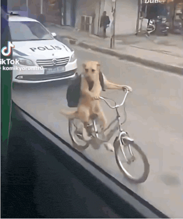

#  I love dogs and programming! Dogs are the best animals!

## Table of contents

- [Laboratory Assignment №1: Conditional Statements and Keyboard Input](https://github.com/Trerran/C_programming/tree/main/lab1_Conditional%20Statements%20and%20Keyboard%20Input)
- [Laboratory Assignment №2: Loops](https://github.com/Trerran/C_programming/tree/main/lab2_loops)
- [Laboratory Assignment №3: Nested Loops](https://github.com/Trerran/C_programming/tree/main/lab3_Nested%20loops)
- [Laboratory Assignment №4: Bitwise Operations](https://github.com/Trerran/C_programming/tree/main/lab4_Bitwise%20operations)
- [Laboratory Assignment №5: Arrays](https://github.com/Trerran/C_programming/tree/main/lab5_Arrays)
- [Laboratory Assignment №6: Matrices](https://github.com/Trerran/C_programming/tree/main/lab6_Matrices)
- [Laboratory Assignment №7: Strings](https://github.com/Trerran/C_programming/tree/main/lab7_Strings)
- [Laboratory Assignment №8: Dynamic Memory](https://github.com/Trerran/C_programming/tree/main/lab8_Dynamic%20memory)
- [ЛLaboratory Assignment №9 Git](https://github.com/Trerran/C_programming/tree/main/lab9_Git)
