# Лабораторная работа №9. Git :white_check_mark:

## Часть 1. Отчет на оценку 3 :memo:

### 1.Использование команды `git status`
Данная команда показывает, какие файлы были изменены, добавлены в коммит или ещё не отслеживаются системой, а также сообщает о состоянии текущей ветки.

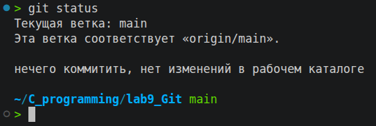

Вывод команды означает, что мы находимся на ветке main и что изменений нет.

### 2.Как выглядит команда `git log`?
Команда `git log` выводит историю коммитов текущего репозитория. В моем случае я добавил директории с лабораторными работами 1-8:

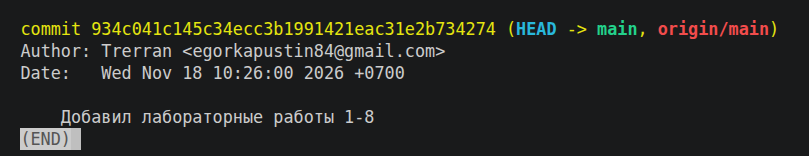

### 3.Создадим файл sort.c и вставим в него функцию сортировки **Bubble Sort**.
Функция сортировки **Bubble sort**:
```c
void bubble_sort(int size, int arr[size]) {
    for (int i = 0; i < size; i++) {
        for (int j = 0; j < size - i - 1; j++) {
            if (arr[j] > arr[j + 1]) { // текущий больше следующего, меняем местами
                int tmp = arr[j];
                arr[j] = arr[j + 1];
                arr[j + 1] = tmp;
            }
        }
    }
}
```

### 4.Посмотрим как изменился `git status`
В выводе команды `git status` можем заметить, что мы по-прежнему находимся в ветке *main*, в ней файлы *report.md* и *sort.c* были изменены, а также добавлены новые файлы в репозиторий *screenshots*, про которые Git еще ничего не знает.

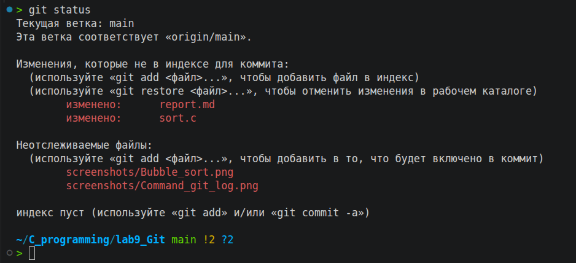

### 5.Добавим файл *sort.c* в состояние staged
Для этого будем использовать команду `git add sort.c`

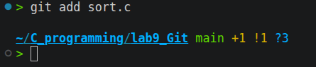

### 6.Посмотрим как изменился `git status`
Увидим, что файл *sort.c* из состояния **"Изменения, которые не в индексе для коммита"** перешел в состояние **"Изменения, которые будут включены в коммит"**

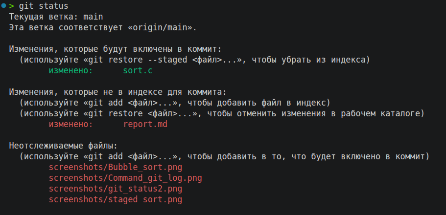

### 7.Закоммитим файл sort.c в репозиторий
Будем использовать команду `git commit sort.c -m "Закоммитил файл sort.c в репозиторий"`

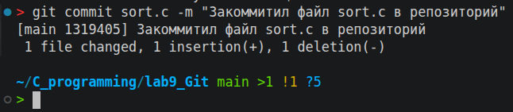

### 8.Проверим, как изменился `git status`
Теперь наша локальная ветка опережает удаленную на 1 коммит

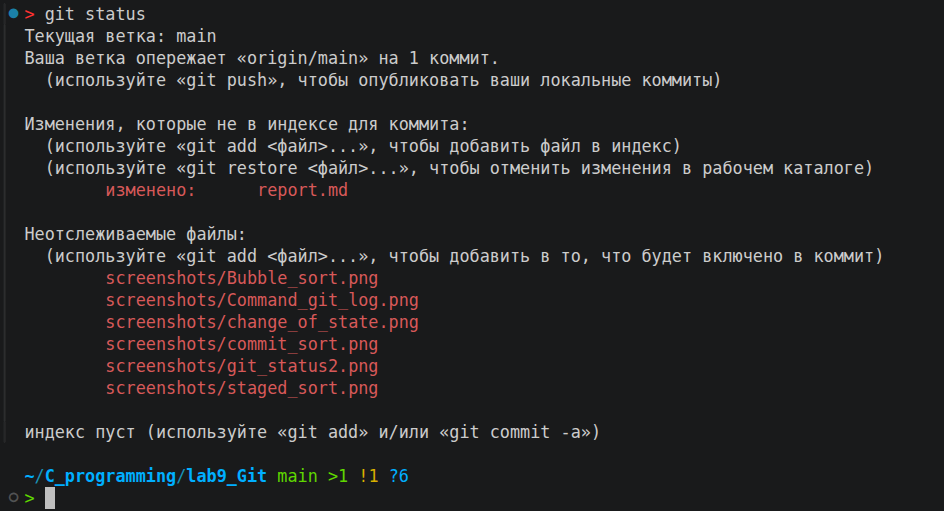

### 9.Добавим комментарий в файл sort.c
Используем команду `echo "//Это одна из самых простых сортировок" >> sort.c`

### 10.Проверим, как изменился `git status`
После нашего добавления комментария в файл прошлый коммит остался, но файл *sort.c* приобрел новый статус **"Изменения, которые не в индексе для коммита"**

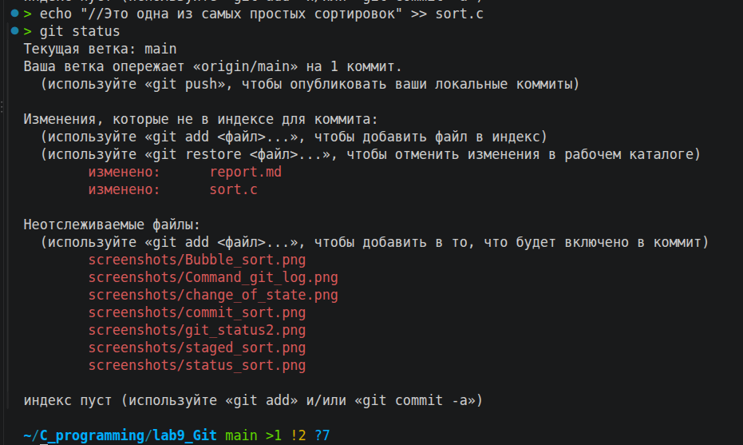

### 11.Добавим файл *sort.c* в состояние **staged**
Для этого будем использовать команду `git add sort.c`

### 12.Проверим, как изменился `git status`
Увидим, что файл *sort.c* из состояния **"Изменения, которые не в индексе для коммита"** перешел в состояние **"Изменения, которые будут включены в коммит"**

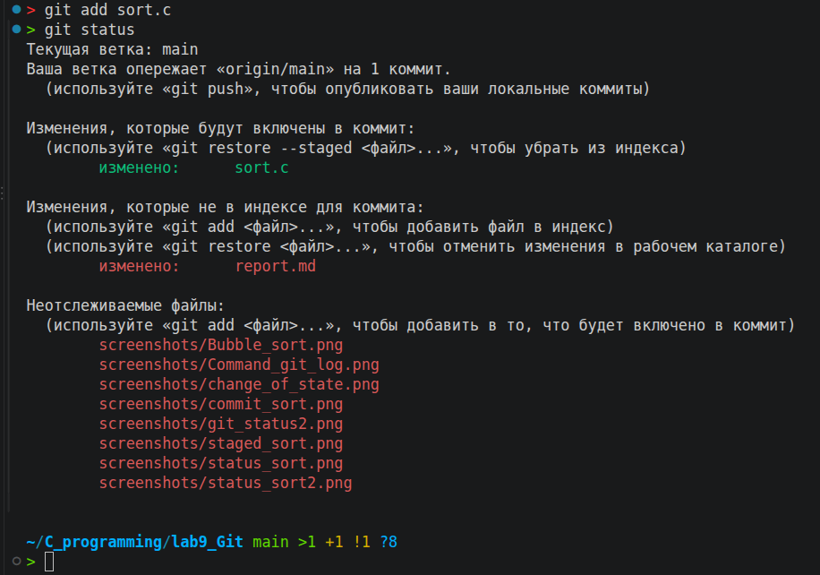

### 13.Добавим еще один комментарий в файл *sort.c*
Используем команду `echo "//В среднем и худшем случаях сложность алгоритма составляет O(n²)" >> sort.c`

### 14.Закоммитим файл *sort.c*
Закоммитим файл *sort.c*, используя команду `git commit sort.c -m "Закоммитил файл sort.c в репозиторий"` 

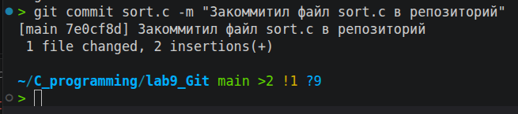

### 15.Посмотрим, как изменился `git status` и `git log`
Теперь наша локальная ветка опережает удаленную уже на 2 коммита 

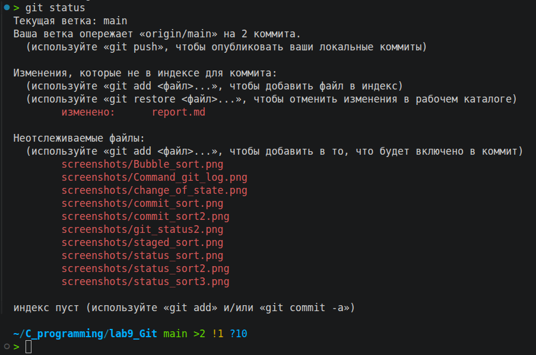

На скриншоте два последних коммита файла *sort.c*, в которых видны **хэш коммиты**, а также время, когда создан каждый из коммитов
> **Хэш коммита** - уникальный 40-символьный идентификатор, который Git автоматически присваивает каждому коммиту

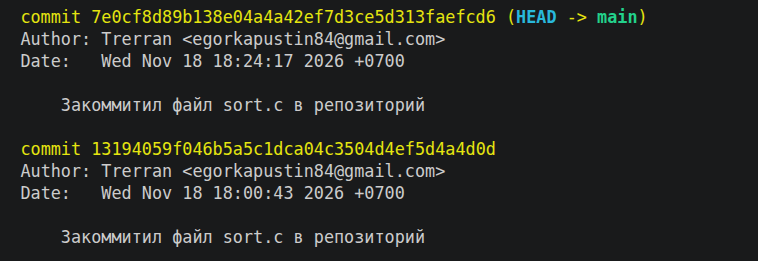

### 16.Закоммитим все созданные файлы
Для начала переведем все файлы в состояние **staged**, используя команду `git add .`, затем закоммитим командой `git commit -m "Закоммитил первую часть отчета"`

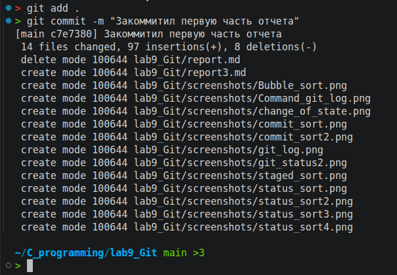

### 17.Запушим все файлы в удаленный репозиторий
Используем команду `git push`

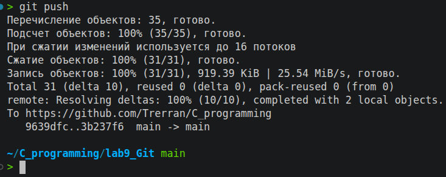

## Часть 2. Отчет на оценку 3 :memo:
### 1-3.Создание новой ветки
С помощью команды `git branch mybranch` создадим новую ветку с именем *mybranch*. Проверим, что ветка создалась командой `git branch`. Переключимся на созданную ветку: `git switch my branch`.

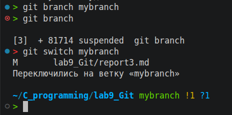
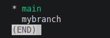

Звездочка в начале названия ветки означает: на какой ветке мы сейчас находимся.

### 4-5.Проверим текущую ветку
Используя команду `git status`, узнаем на какой ветке мы сейчас находимся.

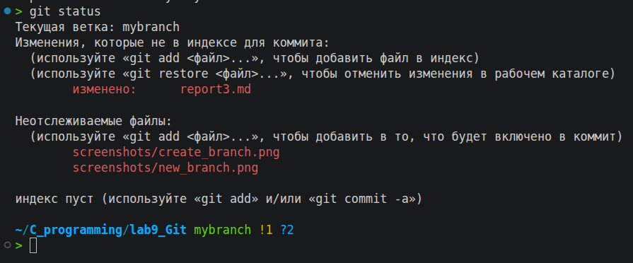

На скриншоте видим, что текущая ветка *mybranch*

### 6-7. Создадим файл в ветке mybranch и закоммитим его
Создадим файл *file1.txt* и запишем в него свое имя

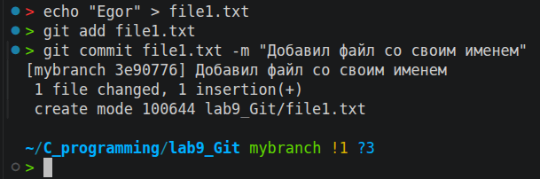

### 8.Проверим, что ветка mybranch указывает на созданный файл
Для этого будем использовать команду `git log --oneline --graph`

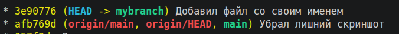

**(HEAD -> mybranch)** данная строка указывает нам, что "голова" находится на ветке *mybranch*

### 9-10.Вернемся в ветку main и проверим вывод команды `git log --oneline --graph`
Вернемся в ветку *main* с помощью команды `git switch main` и введем команду `git log --oneline --graph`

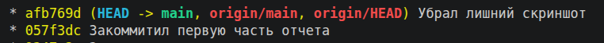

Видим, что теперь "голова" указывает на ветку main, а последним коммитом в ней является **"Убрал лишний скриншот"**. Изменения, зафиксированные в ветке mybranch, в основной ветке *main* не отображаются, так как *mybranch* отпочковалась от главной и развивается изолированно.

### 11.Создадим файл file2.txt и закоммитим его

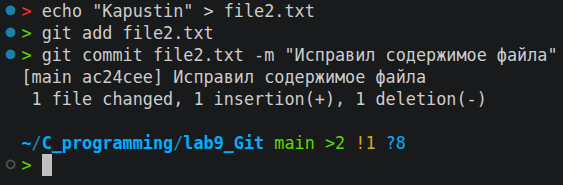

### 12-14.Проверка разветвления веток
С помощью команды `git log --oneline --graph --all` проверим, что ветка *main* указывает на новый коммит и что теперь у веток разные коммиты.

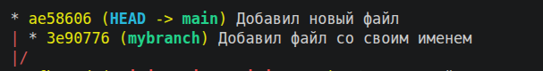

Перейдем в ветку *mybranch* и посмотрим, какие файлы она содержит. Никакого файла *file2.txt* в ней нет, оно и верно, потому что ветка была создана на более раннем коммите, когда еще ветка *main* не хранила в себе данный файл.

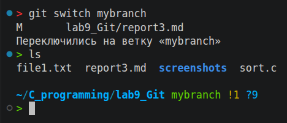

### 15.Посмотрим на разницу в ветках
Для этого будем использовать команду `git diff mybranch main`

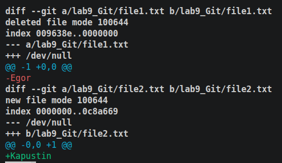

Вывод показывает, что в ветке *mybranch* содержится файл *file1.txt* с текстом **Egor**, а в ветке *main* — *file2.txt* с текстом **Kapustin**.

> На данном этапе выполнения была замечена ошибка, файлы *file1.txt* и *file2.txt* имели одно и то же содержимое, из-за этого Git считал их одним файлом, и выполнение команды не давало должного результата. Было принято решение, перезаписать содержимое в *file2.txt* (скриншот на 11 шаге обновлен).

### 16.Добавим файл с отчетом и скриншоты в ветку mybranch
Если вы закоммитите изменения и отправите обе ветки на *GitHub*, они будут храниться там как две совершенно независимые, параллельные версии вашего проекта, не мешая друг другу. 

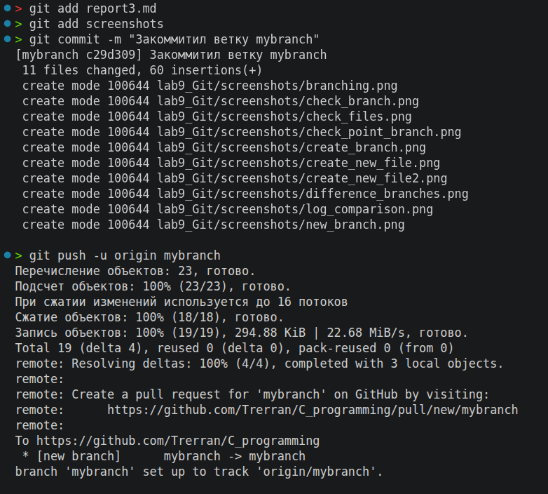

### 17.Проверка веток на GitHub
После отправки локальных изменений в удаленный репозиторий на сервере *GitHub* появились две параллельные ветки: *main* и *mybranch*. Теперь на *GitHub*можно переключаться между ними.

## Итог
- Изучен принцип работы с ветками в *Git*.
- Проверена изоляция веток *main* и *mybranch*.
- Освоены базовые команды Git для работы с репозиторием.
- Изучен полный жизненный цикл файла и его состояния.
- Изучен полный жизненный цикл файла и его состояния.


