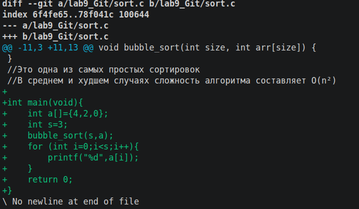
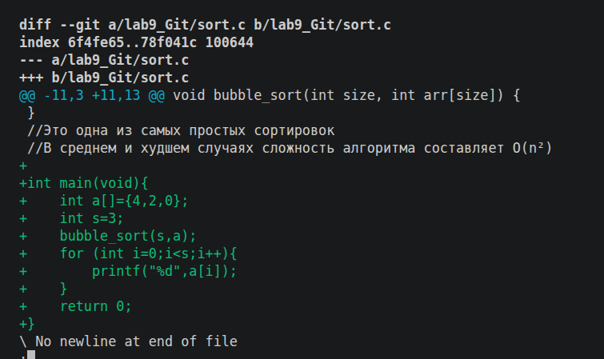
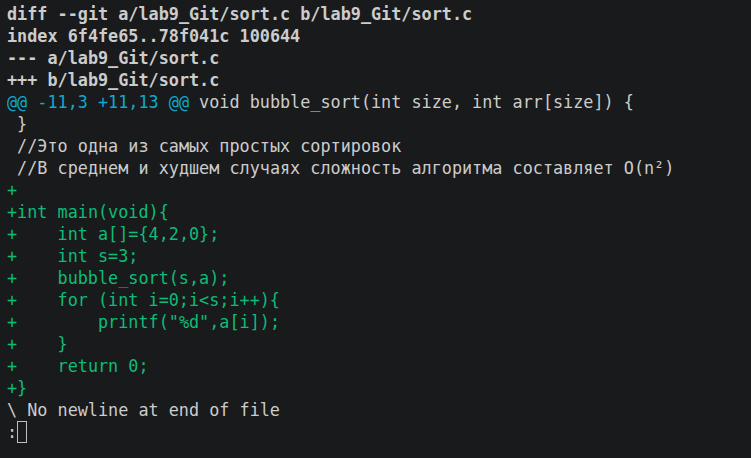
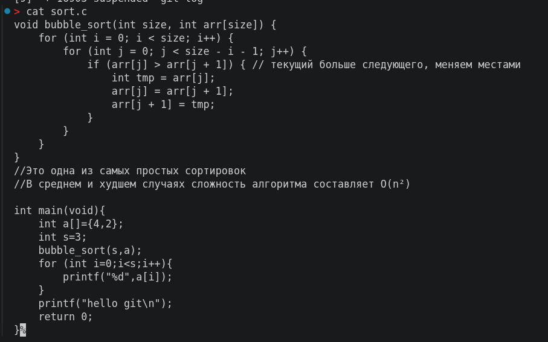
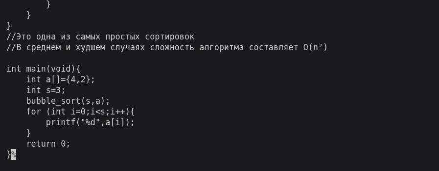

# Лабораторная работа №9. Git :white_check_mark:

## Часть 1. Отчет на оценку 4 :memo:

### 1-2.Перезапишем файл sort.c в ветку mybranch
Переключимся на ветку, с помощью команды `git switch mybranch`. Добавим в файл *sort.c* функцию *main*:

```c
int main(void){
    int a[]={4,2,0};
    int s=3;
    bubble_sort(s,a);
    for (int i=0;i<s;i++){
        printf("%d",a[i]);
    }
    return 0;
}
```
### 3-4.Что говорит команда git diff и git diff --staged?
Команда `git diff` сообщает нам какие изменения произошли файла, в нашем случае мы видим, что были добавлены новые строки в файл *sort.c*



Теперь проверь, что выведет команда `git diff --staged`. Увидим, что изменения через команду `git add` не были добавлена, поэтомы вывод команды пустой.


### 5-7.Что выведут команды git diff и git diff --staged после добавления файла sort.c в состояние staged?
С помощью команды `git add sort.c` добавим файл *sort.c* в состояние **staged**. Проверим вывод команды `git diff`: теперь он пустой, так как файл перешел из неиндексированного состояния в проиндексированное. Зато команда `git diff --staged` теперь непустая и показывает подготовленные к коммиту изменения в файле.




### 8-11.Что выведут команды git diff и git diff --staged после удаления любого числа из массива?
После удаления числа **0** из массива в выводе команды `git diff` увидим, как изменился массив, а вывод команды  `git diff --staged` по-прежнему будет содержать прошлые проиндексированные изменения, так как файл еще не был закоммичен.




#### Итог:
В итоге мы наглядно увидели разницу между тремя состояниями файла в Git: рабочей директорией, состояним staged и последним коммитом. Команда `git diff` всегда показывает только те правки, которые еще не добавлены в индекс, тогда как `git diff --staged` отображает изменения, уже подготовленные к следующему коммиту, даже если после их добавления файл снова редактировался.

### 12.Команда git status
Файл *sort.c* выводится два раза в разных состояниях, это говорит нам, что в состоянии **staged** и в рабочей директории лежат разные версии файлов.


### 13-14.Отменим индексацию файла sort.c
Используем команду `git restore --staged sort.c`. Теперь `git status` содержит всего одну версию файла, которая **не в индексе для коммита**.


### 15-16.Закоммитим файла sort.c
Закоммитим файл *sort.c* и просмотрим, что выведет журнал. 


### 17-19.Добавление новой строки в sort.c
В **main** добавлена строка **printf("hello git\n");**. Содержимое *sort.c*:



Проверим вывод команды `git status`. Увидим, что файла *sort.c* находится в состоянии: **"Изменения, которые не в индексе для коммита"**


### 20-23.Запустим команду git restore sort.c
После использования команды `git restore sort.c` файл *sort.c* потеряет последние непроиндексированные изменения. Также теперь команда `git status` сообщает, что изменений в рабочей директории нет. Запушим на удаленный репо ветку.




## Часть 2. Отчет на оценку 4 :memo:
