# Лабораторная работа №9. Git :white_check_mark:

## Часть 1. Отчет на оценку 4 :memo:

### 1-2.Перезапишем файл sort.c в ветку mybranch
Переключимся на ветку, с помощью команды `git switch mybranch`. Добавим в файл *sort.c* функцию *main*:

```c
int main(void){
    int a[]={4,2,0};
    int s=3;
    bubble_sort(s,a);
    for (int i=0;i<s;i++){
        printf("%d",a[i]);
    }
    return 0;
}
```
### 3-4.Что говорит команда git diff и git diff --staged?
Команда `git diff` сообщает нам какие изменения произошли файла, в нашем случае мы видим, что были добавлены новые строки в файл *sort.c*


Теперь проверь, что выведет команда `git diff --staged`. Увидим, что изменения через команду `git add` не были добавлена, поэтомы вывод команды пустой.


### 5-7.Что выведут команды git diff и git diff --staged после добавления файла sort.c в состояние staged?
С помощью команды `git add sort.c` добавим файл *sort.c* в состояние **staged**. Проверим вывод команды `git diff`: теперь он пустой, так как файл перешел из неиндексированного состояния в проиндексированное. Зато команда `git diff --staged` теперь непустая и показывает подготовленные к коммиту изменения в файле.


### 8-11.Что выведут команды git diff и git diff --staged после удаления любого числа из массива?
После удаления числа **0** из массива в выводе команды `git diff` увидим, как изменился массив, а вывод команды  `git diff --staged` по-прежнему будет содержать прошлые проиндексированные изменения, так как файл еще не был закоммичен.

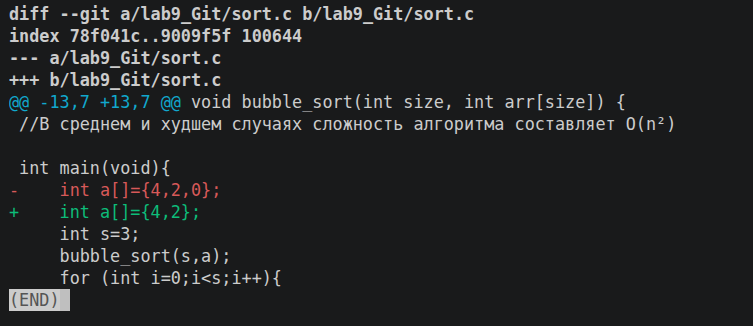


#### Итог:
В итоге мы наглядно увидели разницу между тремя состояниями файла в Git: рабочей директорией, состояним staged и последним коммитом. Команда `git diff` всегда показывает только те правки, которые еще не добавлены в индекс, тогда как `git diff --staged` отображает изменения, уже подготовленные к следующему коммиту, даже если после их добавления файл снова редактировался.

### 12.Команда git status
Файл *sort.c* выводится два раза в разных состояниях, это говорит нам, что в состоянии **staged** и в рабочей директории лежат разные версии файлов.

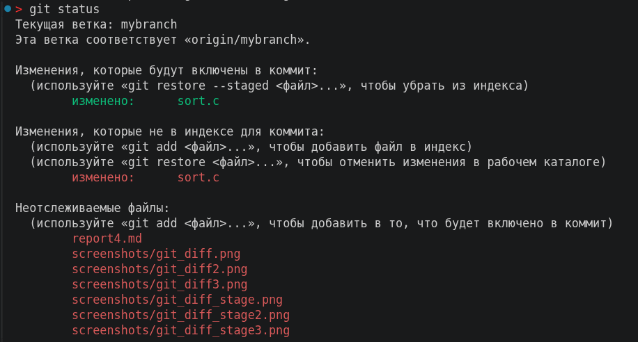

### 13-14.Отменим индексацию файла sort.c
Используем команду `git restore --staged sort.c`. Теперь `git status` содержит всего одну версию файла, которая **не в индексе для коммита**.

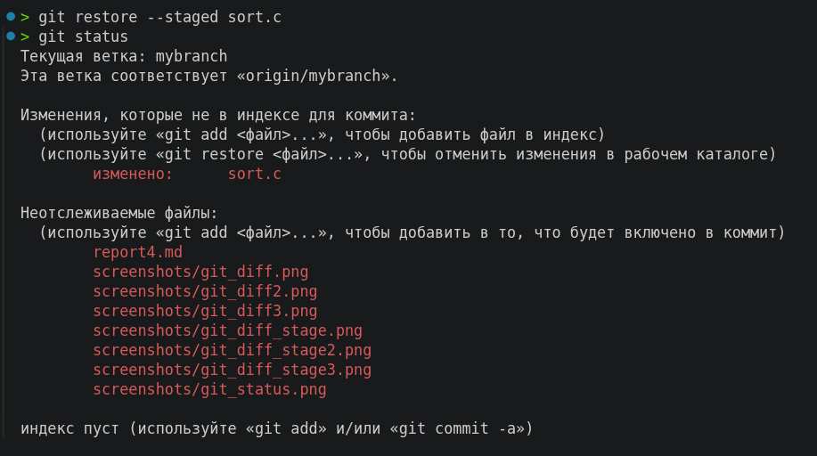

### 15-16.Закоммитим файла sort.c
Закоммитим файл *sort.c* и просмотрим, что выведет журнал. 

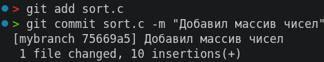

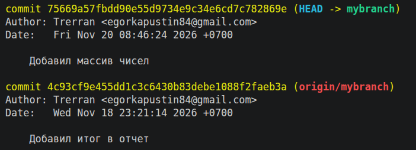

### 17-19.Добавление новой строки в sort.c
В **main** добавлена строка **printf("hello git\n");**. Содержимое *sort.c*:


Проверим вывод команды `git status`. Увидим, что файла *sort.c* находится в состоянии: **"Изменения, которые не в индексе для коммита"**

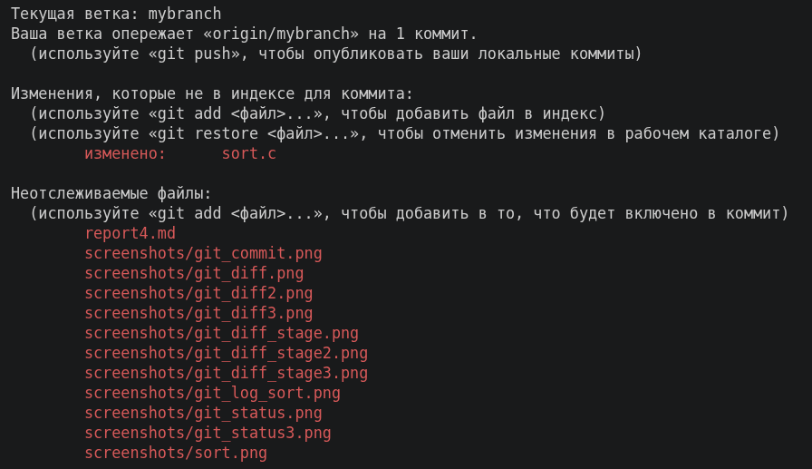

### 20-23.Запустим команду git restore sort.c
После использования команды `git restore sort.c` файл *sort.c* потеряет последние непроиндексированные изменения. Также теперь команда `git status` сообщает, что изменений в рабочей директории нет. Запушим на удаленный репо ветку.


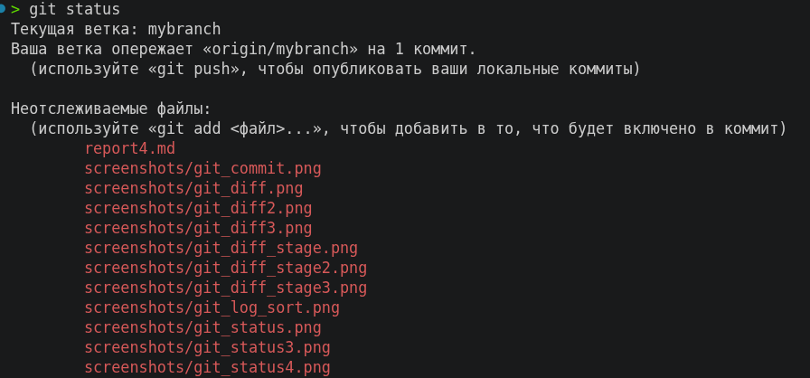

## Часть 2. Отчет на оценку 4 :memo:
### 1.Создадим файл greeting.txt и закоммитим его
Команды:
```bash
touch greeting.txt
git add greeting.txt
git commit greeting.txt -m "Add file greeting.txt"
```

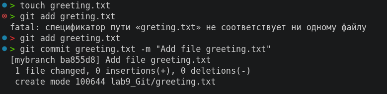

### 2.Добавить в этот файл greeting.txt слово hello и закоммитим его
Команды:
```bash
echo "hello" > greeting.txt
git add greeting.txt
git commit greeting.txt -m "Add content to greeting.txt"
```

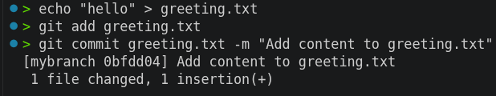

### 3-4.Создадим новую ветку feature/uppercase и перейдем на нее
Команды:
```bash
git branch feature/uppercase
git switch feature/uppercase
```

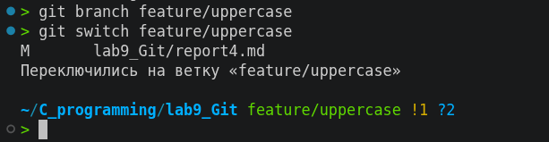

### 5.Вывод команды git status
При создании новой ветки она наследовала текущее состояние коммитов и файлов ветки *mybranch*. Поскольку все изменения были закоммичены, в рабочей директории и индексе нет новых правок.

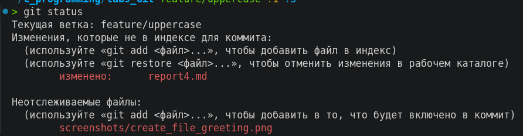

### 6-7.Добавим приветствие в файл greeting.txt
Команды:
```bash
echo "HELLO" > greeting.txt
git add greeting.txt
git commit greeting.txt -m "Add content to greeting.txt"
```

### 8.Вывод команды git branch
Увидим, что у нас есть три ветки: *main*, *mybranch*, *feature/uppercase*. Сейчас мы находимся на ветке *feature/uppercase*, она отмечена звездочкой `*`.

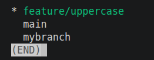

### 9.Вывод команды git log --oneline --graph --all
Увидим, что текущая ветка *feature/uppercase* находится на один коммит  впереди ветки mybranch, от которой она была создана. 

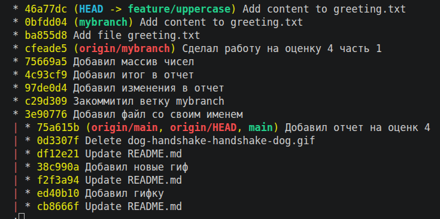

### 10-11.Переключимся на главную ветку и посмотрим содержимое файла greetings.txt
Ветка *main* ничего не знает о файле *greeting.txt*, так как он был создан в побочной ветке *mybranch*, а ветка *feature/uppercase* унаследовала его при ответвлении от *mybranch*.

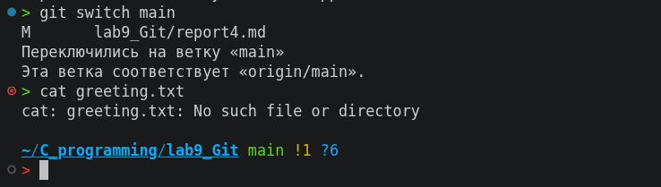

### 12.Сравним ветки main и feature/uppercase
Для этого будем использовать команду `git diff main feature/uppercase`.На скриншоте увидим разницу файлов в папке `lab9_Git` между веткой *main* и веткой *feature/uppercase*. Файл *file2.txt*  присутствует только в *main*, тогда как новые файлы *file1.txt* , *greeting.txt* существуют только в ветке *feature/uppercase*.

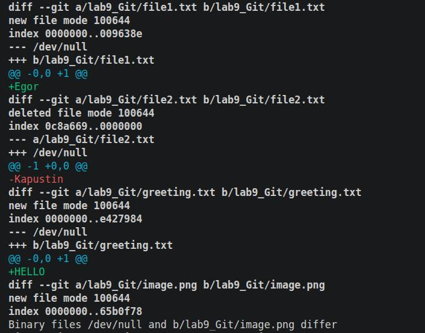

### 13.Обьединим ветки main и feature/uppercase
Так как ветки main и feature/uppercase разошлись, слияние не может быть выполнено в режиме fast-forward, и Git создаёт отдельный merge-коммит с двумя родителями.   

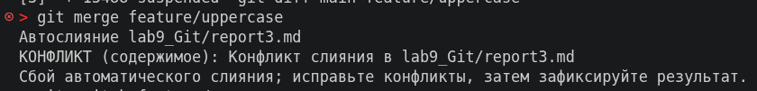

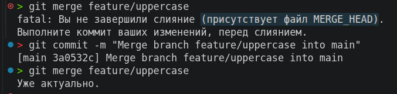

> Во время слияния веток *main* и *feature/uppercase* возник конфликт в файле *report3.md*, так как этот файл одновременно изменялся в обеих ветках после их расхождения. Для разрешения конфликта вручную отредактировали спорные фрагменты, добавили исправленный файл в индекс и завершили процесс.

### 14.Содержимое файла greeting.txt
После слияния веток наша главная ветка узнала о файле *greeting.txt*, и теперь мы можем посмотреть ее содержимое.

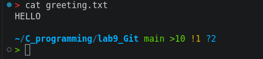

### 15.Удаление ветки feature/uppercase
Команда для удаления ветки: `git branch -d feature/uppercase`

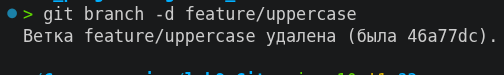

### 16.Смержим ветку mybranch в main
Команда для слияния ветки mybranch в main: `git merge mybranch`. Сообщение на скриншоте **"Уже актуально"** означает, что  все коммиты из ветки *mybranch* уже находятся в ветке *main*.

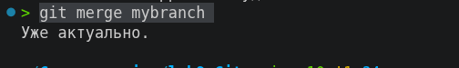

### 17.Что выводит git log --oneline --graph --all?
Т.к ветки *main* и *feature/uppercase* разошлись, слияние не могло быть выполнено в режиме fast-forward, и Git создал отдельный merge-коммит 3a0532c с двумя родителями — 75a615b и 46a77dc. 

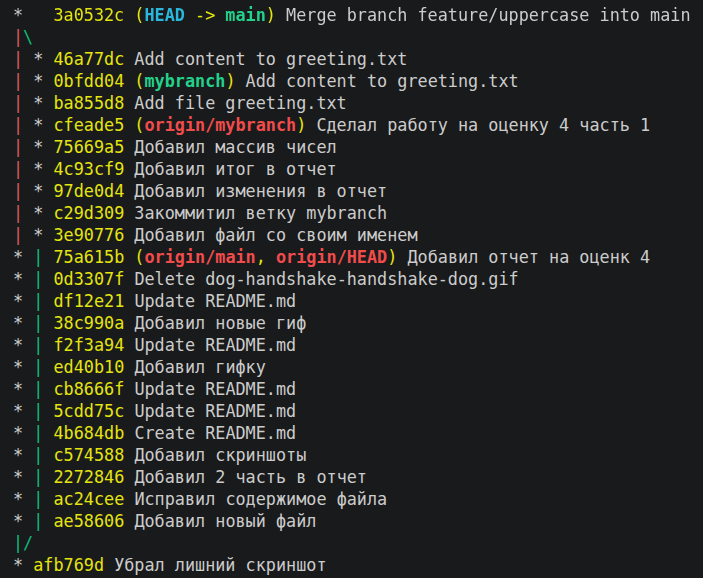

### 18-19.Запушим на удаленный репо ветку main и результат работы
Команды:
```bash
git add .
git commit -m "Добавил результаты работы на оценку 4"
git push
```

### Итог:
- Научились сравнивать состояния файлов.
- Научились управлять индексом и отменять нежелательные изменения с помощью.
- Отработали создание и переключение веток, их сравнение, слияние в основную ветку с разрешением конфликта.
- Удаление неактуальных веток.