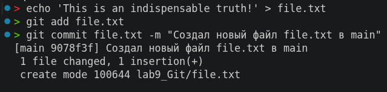
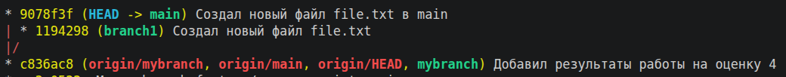
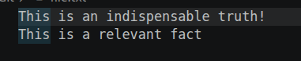

# Лабораторная работа №9. Git :white_check_mark:

## Часть 1. Отчет на оценку 5 :memo:

### 1.Создадим ветку новую ветку branch и переключимся на нее
Команды:
```bash
git branch branch1
git switch branch1
```


### 2-3.Создадим новый файл и закоммитим его
Команды:
```bash
echo "This is a relevant fact" > file.txt
git add file.txt
git commit file.txt -m "Создал новый файл file.txt"
```


### 4-5.Создадим файл в главной ветке и закоммитим его
Команды:
```bash
git switch main
echo 'This is an indispensable truth!' > file.txt
git add file.txt
git commit file.txt -m "Создал новый файл file.txt в main"
```



### 6.Каков вывод git log --oneline --graph --all?
Заметим, что от общего коммита ветки *main* и *branch1* разошлись: в ветке *branch1* создан файл *file.txt*, а в ветке *main* параллельно создан одноименный файл *file.txt*.



### 7.Попытка слияния веток main и brach1
При попытке слияния возникает конфликт, который сообщает нам о том, что в одном и том же файле в разных ветках разное содержимое.


### 8.Что показывает git status?
В выводе команды увидим, что слияния веток в процессе, но оно не может завершится автоматически из-за конфликта в файле file.txt.

### 9.Решение конфликта слияния
Вывод команды `cat file.txt` отображает маркеры конфликта слияния: между `<<<<<<< HEAD` и `=======` находится строка из текущей ветки *main*, а ниже разделителя до `>>>>>>> branch1` — строка из вливаемой ветки *branch1*.


Чтобы решить конфликт удалим маркеры и проиндексируем файл с помощью команды `git add .`




