# Лабораторная работа №9. Git :white_check_mark:

## Часть 1. Отчет на оценку 5 :memo:

### 1.Создадим ветку новую ветку branch и переключимся на нее
Команды:
```bash
git branch branch1
git switch branch1
```

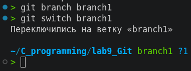

### 2-3.Создадим новый файл и закоммитим его
Команды:
```bash
echo "This is a relevant fact" > file.txt
git add file.txt
git commit file.txt -m "Создал новый файл file.txt"
```

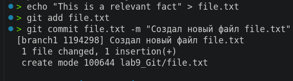

### 4-5.Создадим файл в главной ветке и закоммитим его
Команды:
```bash
git switch main
echo 'This is an indispensable truth!' > file.txt
git add file.txt
git commit file.txt -m "Создал новый файл file.txt в main"
```


### 6.Каков вывод git log --oneline --graph --all?
Заметим, что от общего коммита ветки *main* и *branch1* разошлись: в ветке *branch1* создан файл *file.txt*, а в ветке *main* параллельно создан одноименный файл *file.txt*.


### 7.Попытка слияния веток main и brach1
При попытке слияния возникает конфликт, который сообщает нам о том, что в одном и том же файле в разных ветках разное содержимое.

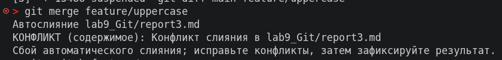

### 8.Что показывает git status?
В выводе команды увидим, что слияния веток в процессе, но оно не может завершится автоматически из-за конфликта в файле file.txt.

### 9.Решение конфликта слияния
Вывод команды `cat file.txt` отображает маркеры конфликта слияния: между `<<<<<<< HEAD` и `=======` находится строка из текущей ветки *main*, а ниже разделителя до `>>>>>>> branch1` — строка из вливаемой ветки *branch1*.

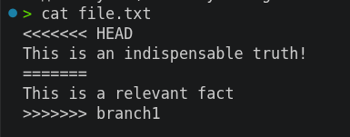

Чтобы решить конфликт удалим маркеры. проиндексируем файл с помощью команды `git add .` и закоммитим его `git commit -m "Исправил конфликт слияния веток"`


После проделанных операций слияние веток успешно завершилось.

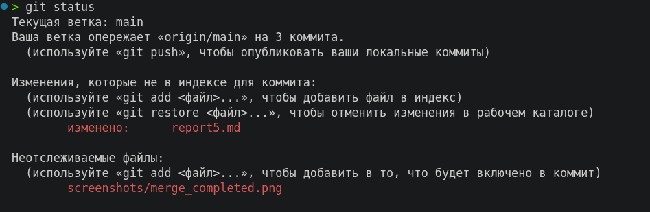

### 10.Что показывает git log --oneline --graph?
После выполнения всех команды в журнале мы увидим, что ветки успешно слились и указывают на один коммит `eda9b46`.

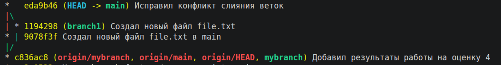

### 11.Запушим на удаленный репо
Команды:
```bash
git add .
git commit -m "Добавил отчет на оценку 5"
git push
```

> Здесь я индексировал и коммитил файл отчета, созданные после прошлого коммита.

## Часть 2. Отчет на оценку 5 :memo:

### 1-2.В ветке main создадим новый файл mergesort.py и закоммитим его
Команды:
```bash
touch mergesort.py
git add mergesort.py
git commit -m "Создал новый файл mergesort.py"
cat mergesort.py
```

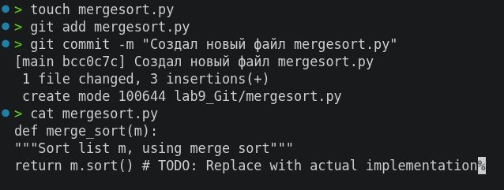

> При копировании кода и файла не сохранилась табуляция, сразу я этого не заметил

### 3.Создадим новую ветку Mergesort-Impl и переключимся на нее.
Команды:
```bash
git branch Mergesort-Impl
git switch Mergesort-Impl
```

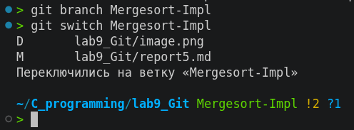

### 4-5.Содержимое файла mergesort.py заменим на код из righty.py и закоммитим изменения
Команды:
```bash
git add mergesort.py
git commit -m "Изменил код в mergesort.py"
cat mergesort.py
```

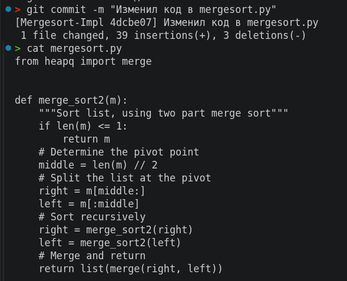

### 6-7.Переключимся на main и изменим все содержимое mergesort.py на lefty.py и закоммитим изменения
Команды:
```bash
git switch main
git add mergesort.py
git commit -m "Изменил код в mergesort.py"
cat mergesort.py
```

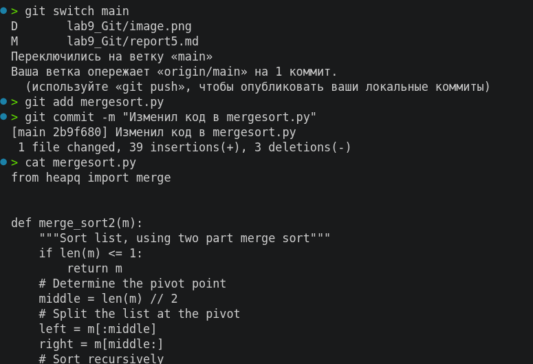

### 8.Что показывает git log --oneline --graph?
Команда выводит историю текущей ветки *main*. Побочная ветка *Mergesort-Impl* в графе не отображается, так как без флага `--all` журнал показывает коммиты только активной ветки.

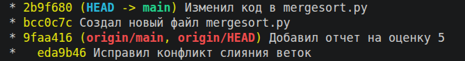

### 9.Что показывает git branch?
В выводе команды `git branch` увидим, что у нас создано 4 ветки и мы сейчас находимся на ветке *main* 

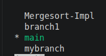

### 10.Cлияние ветки Mergesort-Impl в main
При попытке слияния возникает конфликт, который сообщает нам о том, что в одном и том же файле в разных ветках разное содержимое. 

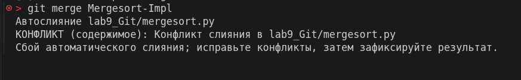

Чтобы решить конфликт слияния, удалим маркеры и оставим код сортировки из ветки *main*.Далее проиндексируем файл с помощью команды `git add .` и закоммитим его `git commit -m "Исправил конфликт слияния ветки Mergesort-Impl в main"`  
